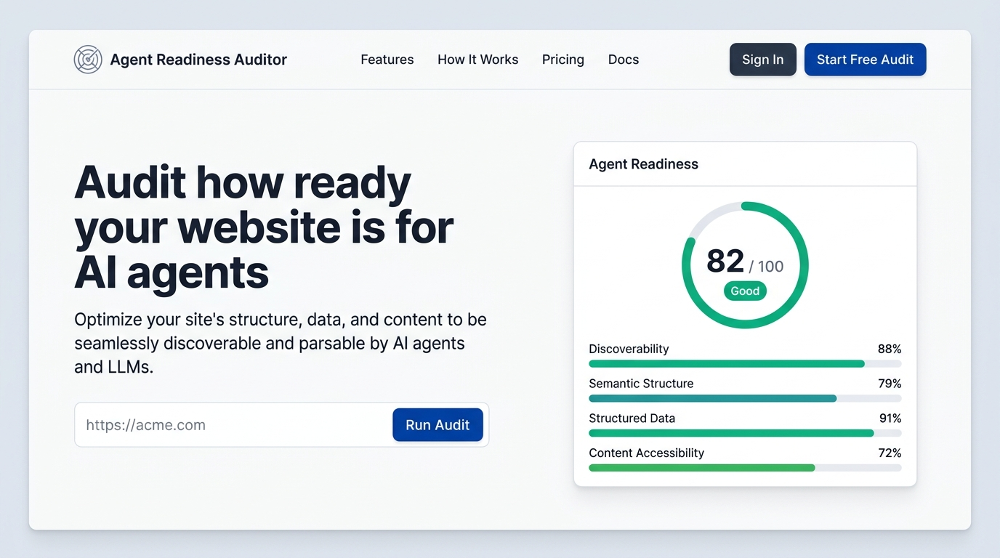
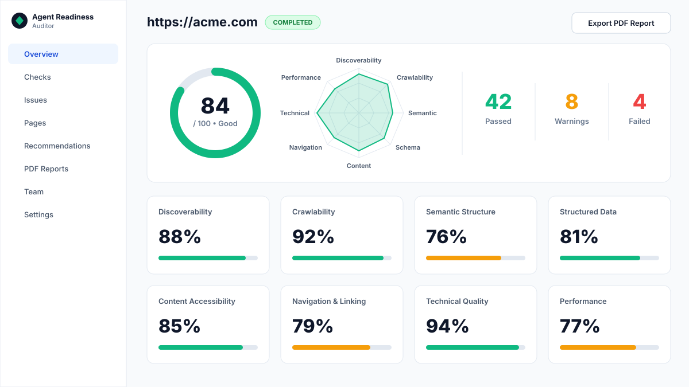
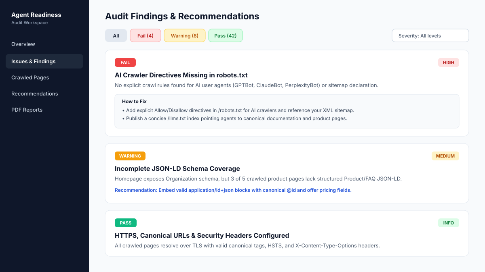

# Agent Readiness Auditor

**Agent Readiness Auditor** is a full-stack web application that crawls any public website and evaluates how ready it is to be **discovered, understood, navigated, and used by AI agents and LLMs**.

It runs an SSRF-safe crawler, executes deterministic technical analyzers across **8 weighted categories**, computes a transparent **Agent Readiness Score (/100)**, prioritizes actionable remediation steps, and exports a downloadable **PDF Audit Report**.

> **Honest positioning:** No tool can guarantee compatibility with every AI agent. This product measures *AI discoverability*, *machine readability*, *structured semantics*, and *technical accessibility* against verifiable checks.

---

## Screenshots

### Landing & Instant URL Audit


### Audit Overview & 8-Category Breakdown


### Findings, Severity Filters & Recommendations


---

## Key Features

- **SSRF-Safe Live Crawler**: Normalizes URLs, validates DNS/IP addresses against private, loopback, link-local, and cloud-metadata ranges, follows redirects safely, and respects `robots.txt` + `sitemap.xml`.
- **10 Deterministic Analyzers**:
  - `robots` (`robots.txt`, AI bot rules, crawl-delay & sitemap references)
  - `sitemap` (`sitemap.xml` discovery, valid XML URLs, coverage)
  - `metadata` (title, meta description, canonicals, Open Graph / Twitter cards)
  - `semantic` (HTML5 landmarks, heading hierarchy, forms/buttons accessibility)
  - `structured_data` (JSON-LD, Microdata, Schema.org entities)
  - `links` (internal linking, anchor quality, broken-link checks)
  - `content` (word count, text-to-HTML ratio, language attributes, image `alt` coverage)
  - `technical` (HTTPS, HTTP status codes, security headers, JS dependency footprint)
  - `performance` (response latency, payload size, TTFB signals)
  - `shopify` (platform detection & storefront structured signals)
- **Weighted Scoring Engine (/100)**: Scores 8 categories into clear ratings (`Critical`, `Poor`, `Moderate`, `Good`, `Excellent`).
- **PDF Report Export**: Generates multi-section A4 PDF audit reports with `pdf-lib` (`GET /api/audits/:id/report`).
- **Multi-Language UI**: English (`en`), French (`fr`), Arabic (`ar` RTL), and Spanish (`es`).
- **Workspaces, Team Invitations, Reviews & Feedback**: Full workspace management, user reviews, application feedback, and super-admin moderation endpoints.

---

## Score Bands

| Score | Rating | Meaning |
| :--- | :--- | :--- |
| **90 – 100** | Excellent | Highly discoverable, structured, and machine-readable |
| **75 – 89** | Good | Solid AI readiness with minor optimization opportunities |
| **60 – 74** | Moderate | Parsable core content, but missing key schemas or signals |
| **40 – 59** | Poor | Significant structural or crawlability barriers for agents |
| **0 – 39** | Critical | Severe blockers preventing reliable AI discovery/parsing |

---

## Architecture & Tech Stack

The project runs as a unified **Node.js + Next.js 15** npm workspace application:

```text
agent-readiness-auditor/
├── package.json                  # Root npm workspace scripts (port 3000)
├── .env.example                  # Environment variable template
├── docs/
│   ├── screenshots/              # UI screenshots used in documentation
│   └── ...
└── frontend/                     # Next.js 15 + React 19 + TypeScript + Tailwind CSS
    ├── app/
    │   ├── api/[...path]/        # Built-in Node.js API Route Handlers (/api/*)
    │   ├── (marketing)/          # Landing, Features, Pricing, FAQ, Docs
    │   ├── (app)/                # Audits, Dashboard, Reports, Team, Settings
    │   ├── (auth)/               # Login, Register, Password Reset
    │   └── admin/                # Super-admin moderation & logs
    ├── components/               # Radix UI + Tailwind components, charts, score ring
    ├── lib/
    │   ├── api.ts                # Typed API client (/api)
    │   └── server/               # Crawler, analyzers, scoring, auth, PDF, store
    └── tests/                    # Vitest + React Testing Library suite
```

---

## Quick Start

### Prerequisites
- **Node.js 20+** (tested on Node.js 22)
- **npm**

### Install & Run Locally

```bash
# 1. Install dependencies
npm install

# 2. Configure environment (optional — defaults work out of the box)
cp .env.example .env

# 3. Start the development server on http://localhost:3000
npm run dev
```

Open **[http://localhost:3000](http://localhost:3000)** in your browser.

### Available Scripts

| Command | Description |
| :--- | :--- |
| `npm run dev` | Starts Next.js dev server on `0.0.0.0:3000` |
| `npm run build` | Builds the standalone production bundle |
| `npm run start` | Runs the production Next.js server on port `3000` |
| `npm run lint` | Runs ESLint (`next lint`) |
| `npm run typecheck` | Runs TypeScript strict type checking (`tsc --noEmit`) |
| `npm test` | Runs the Vitest unit & component test suite |

---

## Environment Variables

Default values work without an external database (in-memory store with live HTTP crawling):

- `NEXT_PUBLIC_API_BASE_URL=/api` — API base path used by the frontend
- `NEXT_PUBLIC_MONETIZATION_ENABLED=false` — Allows anonymous audits (`max_pages=5`) when `false`

To persist data across container restarts in production, provision **Cloud SQL** or a persistent database and wire it into `frontend/lib/server/store.ts`.

---

## API Endpoints Overview

All endpoints are served under `/api/*` by `frontend/app/api/[...path]/route.ts`:

- `GET /api/health` — Service health check
- `POST /api/auth/register`, `POST /api/auth/login`, `POST /api/auth/logout`, `GET /api/auth/me`
- `POST /api/audits`, `GET /api/audits`, `GET /api/audits/:id`, `GET /api/audits/:id/summary`, `GET /api/audits/:id/issues`, `GET /api/audits/:id/pages`, `GET /api/audits/:id/recommendations`, `GET /api/audits/:id/report`
- `GET /api/team`, `POST /api/team/invitations`, `GET /api/invitations/:token`
- `GET /api/reviews`, `POST /api/reviews`, `GET /api/feedback/me`, `POST /api/feedback`
- `GET /api/admin/*` — Platform administration endpoints (`SUPER_ADMIN`)

---

## License

MIT — see [LICENSE](LICENSE).
